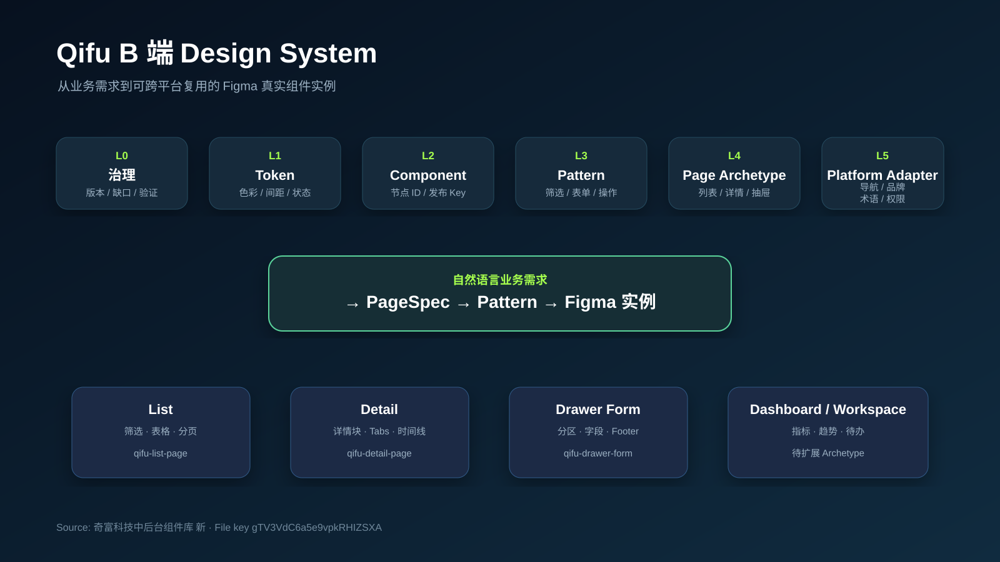
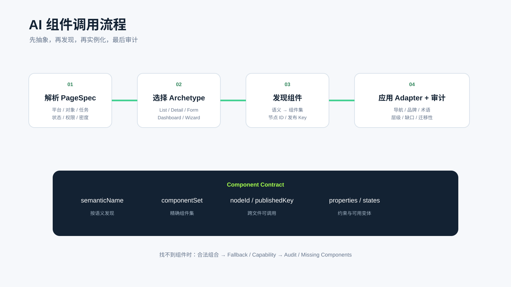
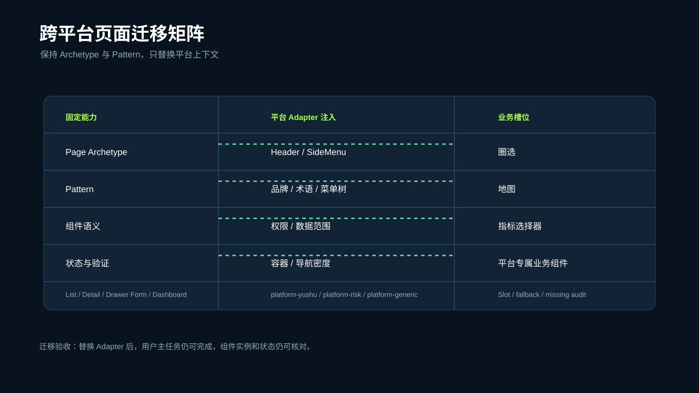

# Qifu Skills

> 奇富 B 端 5 层 AI 设计体系的 skill 集合——把 Token、Component、Pattern、Page Archetype、Business 五层方法论,翻译成 AI 可执行的 Figma 生成 skill。

   

---

## 这个仓库解决什么问题

B 端后台设计碎片化严重:每张页面都从零画图、组件绑定靠手、间距对齐靠眼。本仓库把"5 层 AI 设计体系"落到 **可执行的 Figma 生成 skill** 上:

- 输入:一句中文业务描述(如"在订阅管理下新建群组列表页")
- 输出:Figma 中**保持真实组件实例关系**的完整页面(不是截图、不是手绘)
- 沿途:有契约、有配方、有验证清单、有缺口记录

```
自然语言描述                        Figma 真实组件实例树
"在毓数新建群组列表页,              ── Header(Yushu Header-V2 真实实例)
 筛选有名称/状态/时间"      ──▶    ── SideMenu(SideMenuItem-V2 ×N)
                                   ── List Page Shell-V2
                                       ├── Filter Bar-V2(真实控件 32px)
                                       ├── Table Shell-V2(9 行示例)
                                       └── Pagination-V2
```

## 5 层 AI 设计体系

| 层级 | 名称 | 它是什么 | 在本仓库 |
|---|---|---|---|
| L1 | Design Token | 颜色 / 字体 / 圆角 / 间距 / 边框 | `qifu-shared/references/component-map.md` 第一段 |
| L2 | Component | 真实组件实例 + 节点 ID + 发布 Key | `qifu-shared/references/component-map.md` |
| L3 | Pattern | Filter Bar / Action Bar / DetailBlock 等组合区块 | 各 skill 的 `references/page-rules.md` / `references/page-blueprint.md` |
| L4 | Page Archetype | 列表 / 抽屉表单 / 详情 / 向导… | `skills/qifu-*`(本仓库主资产) |
| L5 | Platform Adapter | 平台导航、品牌、术语、权限、业务槽位 | `qifu-shared/references/platform-*.md` |
| L6 | Business Page | 业务菜单树、用户上下文、业务名词 | 具体交付页面 |

**关键设计**:L1 / L2 / L5 是**跨原型共享资产**,只维护一份(`qifu-shared/references/`);L4 每新增一种原型,只需写 3 份新文件(SKILL.md + blueprint + compositions),复用骨架和共享层。

## 当前 Skill 家族

| Skill | 作用 |
|---|---|
| [qifu-b-end-design-system](./skills/qifu-b-end-design-system/) | 公司级编排入口：页面类型、Pattern、组件调用、跨平台 Adapter 与缺口治理 |

### 页面 Archetype Skills

| Skill | 覆盖场景 | 配方数 | 标准组合 |
|---|---|---:|---|
| [qifu-list-page](./skills/qifu-list-page/) | 列表 + 筛选 + 表格 + 批量 | 6 | Basic Table / Basic Filter / Advanced Filter / Selectable / Loading / Empty |
| [qifu-drawer-form](./skills/qifu-drawer-form/) | 右侧抽屉内新建 / 编辑 / 查看 | 6 | Simple Create / Sectioned Create / Advanced Create / Edit / Readonly / Data Detail with Table |
| [qifu-detail-page](./skills/qifu-detail-page/) | 详情查看 + 局部操作 | 4 | Flat / Tabbed / Master Detail / Readonly |

**真实业务流串起来**:

```
列表页(list) ──点新建──▶ 抽屉表单(drawer-form)
   │                          │
   │                          └─保存─┐
   │                                 ▼
   └──点查看──▶ 详情页(detail) ◀──新建后跳转
                       │
                       └─点编辑──▶ 抽屉表单(Edit)
```

3 个 skill 边界清晰、互不重叠、可相互跳转,覆盖 B 端 90% 高频页面需求。

## 仓库结构

```
qifu-skills-repo/
├── README.md                        ← 你正在读的这份
├── skills/                          ← skill 家族
│   ├── qifu-b-end-design-system/     ← 公司级页面抽象与组件调用编排
│   ├── qifu-shared/                 ← 跨原型共享依赖包(L1/L2/L5 + theme)
│   │   ├── references/
│   │   │   ├── component-map.md     ← 全部真实组件的节点 ID / 发布 Key / 属性
│   │   │   ├── platform-yushu.md    ← 毓数平台导航基线 / 菜单树 / 图标映射
│   │   │   ├── platform-zhikexing.md← 智客星平台基线 / copyTemplate 模板策略
│   │   │   └── platform-generic.md  ← 通用平台适配器
│   │   └── theme/                   ← Figma 变量快照(tokens.json / source / less)
│   ├── qifu-list-page/
│   │   ├── SKILL.md
│   │   ├── references/
│   │   │   ├── page-rules.md
│   │   │   ├── component-map.md
│   │   │   ├── component-invocation-contract.md
│   │   │   ├── structural-validation.md
│   │   │   ├── platform-yushu.md
│   │   │   └── platform-zhikexing.md
│   │   ├── scripts/
│   │   ├── tests/
│   │   ├── agents/openai.yaml
│   │   └── README.md                ← 单个 skill 的详细说明
│   ├── qifu-drawer-form/            ← 同结构
│   └── qifu-detail-page/            ← 同结构
└── skills/qifu-drawer-form/assets/
    └── screenshots/                 ← 已验证的 Figma 场景截图
```


## 架构与调用截图

### 公司级分层架构



### AI 组件调用流程



### 跨平台页面迁移矩阵



> 以上图片是仓库文档用的结构说明图，不替代 Figma 中的真实组件实例。真实组件来源仍以“奇富科技中后台组件库 新”及 `qifu-shared/references/component-map.md` 为准。

## 快速开始

### 使用前提

- 使用支持 Figma Connector / `use_figma` 的 Codex 或 Claude Code；
- 已在自己的 AI 客户端连接个人 Figma 账号；
- 对目标业务文件拥有编辑权限，并能访问「奇富科技中后台组件库 新」；
- 目标文件需要能使用组件库已发布的组件实例。

GitHub 只提供 Skill、规则、示例和截图，不会提供 Figma 登录状态、设计文件权限或任何个人凭证。

### 方式一：直接在仓库中使用

适合希望持续接收更新、同时使用多个 Skill 的同事：

```bash
git clone https://github.com/jingjingtu/qifu-skills.git
cd qifu-skills
```

用 Codex 或 Claude Code 打开该目录；在提示词中写明要使用的 Skill 和目标 Figma 文件。仓库内的 `AGENTS.md` 与共享资料会一起被读取。

### 方式二：安装到个人 Skills（推荐）

先克隆一次仓库，再把需要的 Skill 和 `qifu-shared` 软链到个人目录。`qifu-shared` 是组件映射和平台资料，不能只安装一个页面 Skill 而漏掉它。

### 安装到 Claude Code

```bash
# 假设仓库已克隆到 ~/Documents/qifu-skills
cd ~/Documents/qifu-skills

# 安装全部 Skill；只安装抽屉时保留 qifu-shared、qifu-drawer-form 和 zhikexing-list-page
mkdir -p ~/.claude/skills
for s in qifu-b-end-design-system qifu-shared qifu-list-page qifu-drawer-form qifu-detail-page zhikexing-list-page; do
  ln -sfn "$(pwd)/skills/$s" ~/.claude/skills/$s
done

# 3. 在 Claude Code 中触发
#    $qifu-list-page / $qifu-drawer-form / $qifu-detail-page
```

### 安装到 Codex

```bash
# 假设仓库已克隆到 ~/Documents/qifu-skills
cd ~/Documents/qifu-skills

# 安装全部 Skill；只安装抽屉时保留 qifu-shared、qifu-drawer-form 和 zhikexing-list-page
mkdir -p ~/.codex/skills
for s in qifu-b-end-design-system qifu-shared qifu-list-page qifu-drawer-form qifu-detail-page zhikexing-list-page; do
  ln -sfn "$(pwd)/skills/$s" ~/.codex/skills/$s
done
# Codex 通过每个 skill 下的 agents/openai.yaml 识别入口
```

安装后新开一个 Codex 或 Claude Code 任务，让客户端重新发现 Skill。更新时回到仓库目录执行 `git pull`，软链不需要重新创建。

### 同步策略

GitHub 仓库中的 `skills/` 是唯一主结构。`qifu-shared` 统一维护组件映射、平台基线和主题变量；Nutstore 与本地 Codex 运行目录不再各自保留一套引用路径。

```bash
# 同步抽屉及其直接依赖
./sync.sh qifu-drawer-form qifu-shared zhikexing-list-page

# 同步仓库管理的全部 Skill
./sync.sh
```

脚本固定从当前 GitHub 工作树分发到 Nutstore 与 `~/.codex/skills`，并在每个 Skill 同步后执行目录差异检查。修改规则时先改仓库、校验并提交，再运行同步脚本。

## 提示词结构与示例

先选择页面类型，再复制相应模板；组件名、节点 ID、菜单层级、Slot 和属性写入规则已经在 Skill 内，不需要在提示词里重复。

| 你要生成什么 | 使用哪个 Skill | 从哪里复制提示词 |
| --- | --- | --- |
| 筛选、表格、批量操作的列表页 | `qifu-list-page` | [列表页 README](./skills/qifu-list-page/README.md) |
| 新建、编辑、查看的右侧抽屉 | `qifu-drawer-form` | 直接复制[抽屉 README](./skills/qifu-drawer-form/README.md#一套模板)中的唯一模板 |
| 摘要、信息分组和局部操作的详情页 | `qifu-detail-page` | [详情页 README](./skills/qifu-detail-page/README.md) |

### 抽屉提示词

`qifu-drawer-form` 的公开文档保留一套共享模板，以及两个已验证案例：“新增短信模板策略”和“超频流控配置”。请直接查看 [抽屉 README](./skills/qifu-drawer-form/README.md#一套模板)。

### 在 Figma 中使用

需要:

- Figma 桌面端(选中目标 Page 后,AI 会在其中创建 Frame)
- 目标 Figma 文件已能访问「奇富科技中后台组件库 新」(文件 key `gTV3VdC6a5e9vpkRHIZSXA`)
- AI 客户端已配置 Figma MCP 工具(`use_figma`、`figma-generate-design` 等)

测试 / 效果验证 / Skill 回归时,统一放入 Page **测试**(node `3497:651`),禁止新建近义 Page。

## 提示词示例

列表页标准模板:

```text
使用 qifu-list-page Skill，并调用 @figma 插件，在【Figma 地址】的【目标 Page】生成【页面名称】。
平台：【yushu / zhikexing / generic】。
当前菜单路径：【一级菜单 > 二级菜单 > 三级菜单】。
页面标题：【显示 / 不显示】，标题文案：【标题】。
筛选字段：【字段名 + 控件类型】。
左侧是否有多选框：【是 / 否，不填默认否】。
列表操作栏左侧：【按钮】。
列表操作栏右侧：【按钮】。
主操作：【按钮文案】，位置：【列表最左侧 / 列表最右侧】。
表格列：【列名】。
行操作：【操作】。
状态枚举：【状态名】。
示例数据：【条数】；分页：【总数、每页条数】；画板尺寸：【1366×768 / 1920×1080】。
补充要求：【菜单路径只控制左侧菜单 / 不生成面包屑 / 其他要求】。
```

完整示例:

```text
使用 qifu-list-page Skill，并调用 @figma 插件，在【https://www.figma.com/design/gTV3VdC6a5e9vpkRHIZSXA/奇富科技中后台组件库-新?node-id=3497-651】的“测试”Page 生成“数据质量告警记录列表页”。
平台：yushu。
当前菜单路径：风险监控 > 数据质量监控 > 告警记录。
页面标题：显示“数据质量告警记录”。
筛选字段：告警名称、所属项目、告警级别、处置状态、发生时间。
表格左侧是否有多选框：是。
列表操作栏左侧“批量确认、批量关闭”。
主操作：“新建质量规则”，位置：列表最右侧。
表格列：告警名称、所属项目、告警级别、负责人、处置状态、发生时间、操作。
行操作：查看、立即处理、关闭。
告警级别：提示、一般、严重。
处置状态：待处理、处理中、已解决、已关闭。
示例数据：8条；分页：总数126、每页20条；画板尺寸：1366×768。
当前菜单路径只用于生成和选中左侧菜单层级，不在内容区域生成面包屑。
```

## 更新

修改规则时先改仓库，跑完校验后再用 `./sync.sh` 同步到 Nutstore 与本地 Codex 运行目录。

## 截图展示

> 已提交两张可追溯的抽屉案例截图：智能运营案例来自 Figma Golden Sample，智客星案例来自可交互业务页面的真实打开态。它们用于展示目标结果，不替代组件实例、结构或平台底图验收。

| 缩略 | 说明 | 来源 |
|---|---|---|
| [`smartops-strategy-drawer.png`](./skills/qifu-drawer-form/assets/screenshots/smartops-strategy-drawer.png) | 智能运营平台“新增短信模板策略”打开态 | [Figma node 5066:9446](https://www.figma.com/design/gTV3VdC6a5e9vpkRHIZSXA/%E5%A5%87%E5%AF%8C%E7%A7%91%E6%8A%80%E4%B8%AD%E5%90%8E%E5%8F%B0%E7%BB%84%E4%BB%B6%E5%BA%93-%E6%96%B0?node-id=5066-9446) |
| [`zhikexing-overfrequency-drawer.png`](./skills/qifu-drawer-form/assets/screenshots/zhikexing-overfrequency-drawer.png) | 智客星“超频流控配置”打开态 | 本机可交互业务页面截图 |

## 边界声明

每个 skill 都有明确的"不做什么",在 `SKILL.md` 的 frontmatter `description` 字段和"硬性约束"一节:

- **qifu-list-page** 不做:复杂分析看板、编辑表单、详情页、树表、高度定制工作台
- **qifu-drawer-form** 不做:复杂看板、向导流、带批量编辑的列表页
- **qifu-detail-page** 不做:新建/编辑表单(走 drawer-form)、多记录列表(走 list-page)、数据看板、树表

跨原型借用组合名是**严格禁止**的,每个 skill 的 compositions 只对自己的原型负责。

## 设计原则

- **真实组件实例,不手绘 / 不分离 / 不改母版**
- **组合名严格注册,L4 一个 skill 一种原型**
- **共享资产跨原型复用,不拷贝**
- **缺口诚实记录 Fallback / Audit,不冒充已支持**
- **设计师是规则制定者与验收者,AI 是执行者**

## 路线图

- [x] 5 层方法论(PPT 汇报)
- [x] qifu-list-page(2026-08-12 前已有)
- [x] qifu-drawer-form(2026-08-12)
- [x] qifu-detail-page(2026-08-12)
- [ ] qifu-wizard(分步向导,如 AB 实验创建)
- [ ] qifu-workbench(工作台)
- [ ] qifu-page-form(整页表单,非抽屉)
- [ ] 用真实业务跑通 3 个 skill 并沉淀"已知限制"清单

## 相关链接

- 方法论汇报:可在 [design-meeting](https://github.com/jingjingtu/design-meeting)(私有)找到本期 PPT
- 月报生成:[monthly-report](https://github.com/jingjingtu/monthly-report)
- HTML → Figma 高保真导入:[html-to-figma-fidelity](https://github.com/jingjingtu/html-to-figma-fidelity)

---

**维护者**:师静雅 · Qifu B 端设计
**首次推送**:2026-08-13
**结构版本**:v1.0(5 层体系落地的最初形态)

## Codex installation

The Qifu page skills share component and navigation references. Install all four packages together so every page skill can resolve its dependencies:

```bash
python3 ~/.codex/skills/.system/skill-installer/scripts/install-skill-from-github.py \
  --repo jingjingtu/qifu-skills \
  --path skills/qifu-b-end-design-system skills/qifu-shared skills/qifu-list-page skills/qifu-detail-page skills/qifu-drawer-form skills/zhikexing-list-page \
  --method git
```

`qifu-shared` is an internal dependency package; it should remain installed beside the three page-generation skills.

## Figma 真实语义变量（2026-08-20）

组件库 Variables 已按 Figma 的**真实 collection、mode、分组、变量路径和值/Alias**整理到 [`skills/qifu-shared/theme/`](skills/qifu-shared/theme/)。

- 总计 278 个变量：基础 107、色彩 82、字体 27、圆角 7、尺寸 55；
- AI 调用 Token 时先读取 [`skills/qifu-shared/theme/tokens.json`](skills/qifu-shared/theme/tokens.json)，需要核对模式和值时读取 `skills/qifu-shared/theme/source/*.json`；
- 不允许把工程 Less 的导出标识符或说明性名称当作 Figma 原变量名；Figma 原路径以 `figmaPath` 为准。
