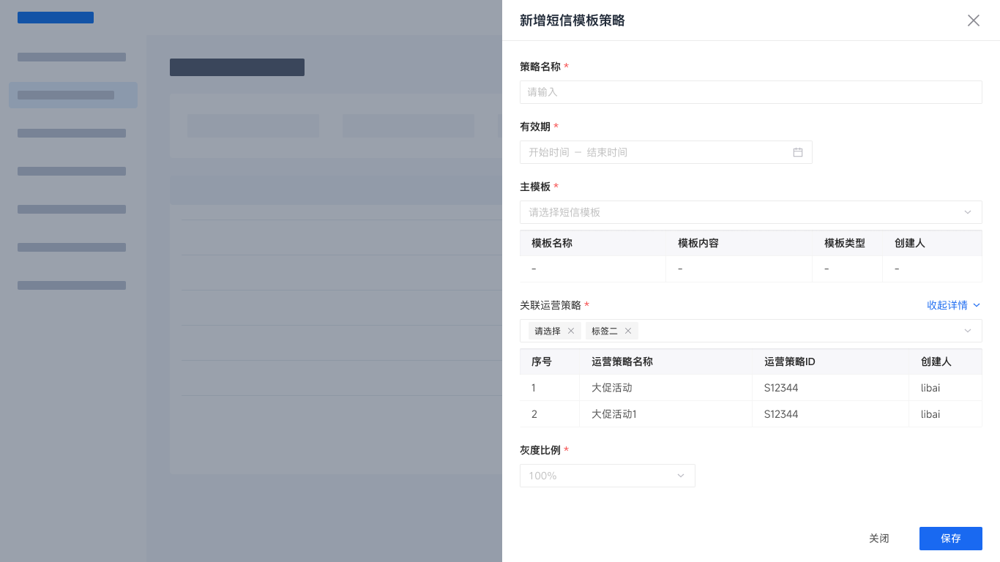
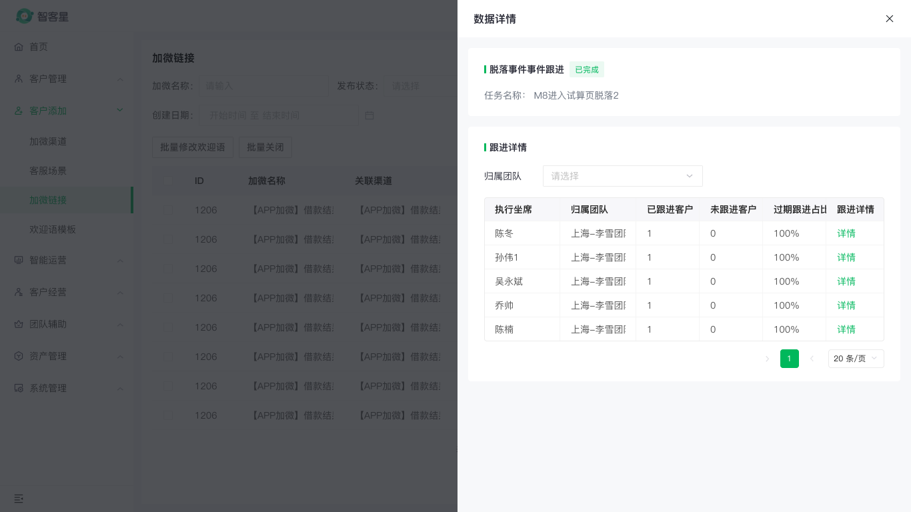

# qifu-drawer-form

在 Figma 中生成可继续编辑的奇富后台右侧抽屉。它会复用真实组件实例，而不是把控件画成分散的矩形和文字。

## 已验证案例

### 智能运营平台：新增短信模板策略



- [查看 Figma Golden Sample](https://www.figma.com/design/gTV3VdC6a5e9vpkRHIZSXA/%E5%A5%87%E5%AF%8C%E7%A7%91%E6%8A%80%E4%B8%AD%E5%90%8E%E5%8F%B0%E7%BB%84%E4%BB%B6%E5%BA%93-%E6%96%B0?node-id=5066-9446)：`1366 × 768`，包含底图、蒙层和右侧 `680px` 抽屉。
- 这是智能运营平台的**结构预览**：底图用于表达打开态结构，不代表已经有可验收的智能运营原生列表页。
- 已验证的业务组合：策略名称、有效期、主模板 + 模板明细表、关联运营策略 + 多选 Tag + 策略明细表、灰度比例，以及“关闭 / 保存”Footer。

### 数据详情：明细表与分页



- [查看 Figma Golden Sample](https://www.figma.com/design/gTV3VdC6a5e9vpkRHIZSXA/%E5%A5%87%E5%AF%8C%E7%A7%91%E6%8A%80%E4%B8%AD%E5%90%8E%E5%8F%B0%E7%BB%84%E4%BB%B6%E5%BA%93-%E6%96%B0?node-id=4725-1548)：`1366 × 768`，真实列表页底图 + 蒙层 + `680px` 数据详情抽屉。
- 适用于“先看摘要，再筛选、查看明细表和分页”的场景；不要把它当作普通新建表单来套。

## 安装到个人 Skills

使用者需要已连接自己的 Figma 账号，并拥有目标业务文件和「奇富科技中后台组件库 新」的访问权限。GitHub 只提供 Skill、示例和规则，不会提供 Figma 登录或编辑权限。

### Codex

```bash
git clone https://github.com/jingjingtu/qifu-skills.git ~/Documents/qifu-skills
mkdir -p ~/.codex/skills
ln -sfn ~/Documents/qifu-skills/skills/qifu-shared ~/.codex/skills/qifu-shared
ln -sfn ~/Documents/qifu-skills/skills/qifu-drawer-form ~/.codex/skills/qifu-drawer-form
```

### Claude Code

```bash
git clone https://github.com/jingjingtu/qifu-skills.git ~/Documents/qifu-skills
mkdir -p ~/.claude/skills
ln -sfn ~/Documents/qifu-skills/skills/qifu-shared ~/.claude/skills/qifu-shared
ln -sfn ~/Documents/qifu-skills/skills/qifu-drawer-form ~/.claude/skills/qifu-drawer-form
```

完成后新开一个任务，再在输入框里使用 `$qifu-drawer-form` 或直接说“使用 qifu-drawer-form”。更新时进入 `~/Documents/qifu-skills` 执行 `git pull`；软链不需要重新创建。

## 最短调用方式

普通场景只需要说清三件事：**平台、抽屉标题、字段**。例如：

```text
使用 qifu-drawer-form，在智客星生成“新建活动”右侧抽屉。
字段：活动名称 Input 必填；活动类型 Select 必填；有效期 DateRange 必填。
```

Skill 会自动补全默认组合、宽度和 Footer。字段较多或有明确交付要求时，再补充下列可选项：

| 可选项 | 何时需要写 | 示例 |
| --- | --- | --- |
| `platformKey` | 要准确切换平台时 | `zhikexing` |
| `themeKey` | 要明确切换主题色时 | `smartops-blue` |
| `compositionName` | 已确定抽屉组合时 | `Qifu Drawer Form / Sectioned Create` |
| `widthTier` | 有固定宽度要求时 | `680` |
| `componentMode` | 没有正式组件库权限时 | `PORTABLE_KIT` |
| `background` | 需要交付完整打开态页面时 | `EXISTING_LIST_PAGE + 节点 ID` |

默认 `componentMode=REAL_COMPONENT_ONLY`。没有正式组件库时，请明确写 `componentMode=PORTABLE_KIT`；不要让 Skill 用手绘控件替代组件。

## 给别人使用时，先选这三种写法

1. **最短描述**：只适合普通新建或编辑表单。写平台、标题和字段，Skill 补齐默认分区、宽度和 Footer。
2. **通用替换模板**：适合需要稳定复用、需要把业务值交给其他同事替换的场景。直接复制下一节，只替换 `<尖括号>` 内的内容。
3. **Golden Sample 提示词**：字段下面还需要明细表、分页、多个 Tag 或平台固定样式时，选本 README 的智能运营或数据详情示例，不要硬塞进普通模板。

## 通用可替换模板

下面这段可原样复制。只替换 `<...>` 中的业务值；没有的字段或分区直接删掉，不要留占位符。

```text
使用 qifu-drawer-form，在<平台名称>生成“<新建 / 编辑 / 查看><业务对象>”右侧抽屉。

platformKey：<zhikexing | yushu | zhineng-yunying | qifu-generic>
themeKey：<zhikexing-green | yushu-green | smartops-blue | custom>
<仅 custom 填写> themePrimary：<#主色>
componentMode：REAL_COMPONENT_ONLY
presentationMode：DRAWER_OPEN_WITH_BACKGROUND
background.source：AUTO
<已有正式列表页时填写> background.sourceNode：<已验收列表页节点 ID>

抽屉标题：<新建 / 编辑 / 查看><业务对象>。
业务页面：<当前列表页或业务模块名称>。

分区：
- <分区一，例如基础信息>：<字段标签> <Input / Select / DateRange / Textarea> <必填或选填>；<字段标签> <控件> <必填或选填>。
- <分区二，例如任务规则>：<字段标签> <控件> <必填或选填>；<字段标签> <控件> <必填或选填>。

<编辑场景补充> 默认值：<字段标签>=<业务值>；<字段标签>=<业务值>。
底部按钮：<取消 / 关闭>、<确定 / 保存>。
```

| 需要替换的值 | 怎么填写 | 示例 |
| --- | --- | --- |
| `<平台名称>` | 使用业务里实际的平台名 | 智能运营平台 |
| `platformKey` | 用固定英文标识，不要自行翻译 | `zhineng-yunying` |
| `themeKey` | 只决定主题色，不决定平台 | `smartops-blue` |
| `<业务对象>` | 用业务对象名，不写“表单” | 短信模板策略 |
| `<分区>` | 2 至 4 个字的名词短语 | 基础信息、任务规则 |
| `<字段标签>` | 用户在页面上看到的字段名 | 策略名称、有效期 |
| `<控件>` | 从 `Input / Select / DateRange / Textarea` 等已支持类型中选 | `DateRange` |
| `background.sourceNode` | 仅已有验收通过的真实列表页时填写 | `5079:9729` |

`background.source=AUTO` 是默认安全写法：优先使用你提供的真实列表页，其次使用平台模板；都没有时仍生成带中性结构预览底图和蒙层的 `1366 × 768` 打开态，不会只留下裸抽屉。正式平台页面是否通过，仍以真实列表页底图验收为准。

## 平台和主题是两件事

- **平台 `platformKey`**：决定平台名称、菜单/底图规则和业务壳。
- **主题 `themeKey`**：只改变主按钮、选中态、链接、轻量 Tag 和强调色。

换主题不会改变字段、控件、间距、圆角、阴影或 Footer。也不要为蓝色主题复制一套组件库。

| 平台 | `platformKey` | 默认主题 | 完整页面底图规则 |
| --- | --- | --- | --- |
| 智客星 | `zhikexing` | `zhikexing-green` | 可使用已验证的智客星列表页模板。 |
| 毓数 | `yushu` | `yushu-green` | 使用毓数平台基线；需指定或验收底图。 |
| 智能运营平台 | `zhineng-yunying` | `smartops-blue` | 默认先生成 `1366×768` 结构预览底图 + 蒙层；提供已验收列表页后升级为正式页面。 |
| 奇富通用后台 | `qifu-generic` | `zhikexing-green` | 默认生成中性结构预览底图 + 蒙层，不套用其他平台菜单。 |

| 主题 | `themeKey` | 主色 |
| --- | --- | --- |
| 智客星绿 | `zhikexing-green` | `#00B578` |
| 毓数绿 | `yushu-green` | 以目标文件变量为准 |
| 智能运营蓝 | `smartops-blue` | `#1677FF` |
| 自定义主题 | `custom` | 必须同时给出 `themePrimary` |

## 何时需要完整页面

正式交付默认生成抽屉“打开态”：`Background < Overlay Mask < Drawer`，画面为 `1366 × 768`。抽屉本体调试可以写 `presentationMode=STANDALONE_DEBUG`，但不能把它当成正式页面交付。

智能运营平台目前已有抽屉 Golden Sample，但没有已批准的原生列表页模板。因此：

- 默认使用 `background.source=AUTO`，先生成 `1366×768` 的结构预览底图 + 蒙层 + 右侧抽屉，不再生成裸抽屉。
- 提供 `background.source=EXISTING_LIST_PAGE` 和 `background.sourceNode=<已验收列表页节点 ID>` 后，自动替换为正式列表页底图。
- 结构预览不借用智客星或毓数菜单；图片背景只能用于视觉对照，不能作为正式页面底图。

## 示例提示词

### 1. 通用抽屉，最短写法

```text
使用 qifu-drawer-form，生成“新建活动”右侧抽屉。
字段：活动名称 Input 必填；活动类型 Select 必填；活动有效期 DateRange 必填；活动说明 Textarea。
```

### 2. 智客星完整页面

```text
使用 qifu-drawer-form，在智客星生成“新建活动”右侧抽屉的完整打开态页面。
platformKey：zhikexing
themeKey：zhikexing-green
componentMode：REAL_COMPONENT_ONLY
background.source：TEMPLATE
当前菜单：客户运营 / 活动管理

字段：活动名称 Input 必填；活动类型 Select 必填；活动有效期 DateRange 必填；活动说明 Textarea。
底部按钮：取消、确定。
```

### 3. 毓数平台

```text
使用 qifu-drawer-form，在毓数生成“编辑数据任务”右侧抽屉。
platformKey：yushu
themeKey：yushu-green
componentMode：REAL_COMPONENT_ONLY
compositionName：Qifu Drawer Form / Edit

字段：任务名称 Input 必填，默认值“用户标签同步”；执行周期 Select 必填，默认值“每日”；生效时间 DateRange；任务说明 Textarea。
底部按钮：取消、保存。
```

### 4. 智能运营 Golden Sample 抽屉

```text
使用 qifu-drawer-form，在智能运营平台生成“新增短信模板策略”右侧抽屉。
platformKey：zhineng-yunying
platformName：智能运营平台
themeKey：smartops-blue
themePrimary：#1677FF
componentMode：REAL_COMPONENT_ONLY
compositionName：Qifu Drawer Form / Sectioned Create
widthTier：680
presentationMode：DRAWER_OPEN_WITH_BACKGROUND
background.source：AUTO
使用“智能运营平台策略关联抽屉 Golden Sample”。

字段：策略名称 Input 必填；有效期 DateRange 必填；主模板 Select 必填并在下方展示模板明细表；关联运营策略 Multiple Select 必填并在下方展示策略明细表；灰度比例 Select 必填，默认值“100%”。
底部按钮：关闭、保存。
```

生成后应与上方“智能运营平台：新增短信模板策略”截图保持同一种信息结构：两个“选择器 + 明细表”组合分别随数据撑开，抽屉外有结构预览底图与蒙层；没有真实列表页时，不应声称已完成正式平台页面验收。

### 5. 智能运营正式完整页面

```text
使用 qifu-drawer-form，根据“智能运营平台策略关联抽屉 Golden Sample”生成完整打开态页面。
platformKey：zhineng-yunying
themeKey：smartops-blue
componentMode：REAL_COMPONENT_ONLY
background.source：EXISTING_LIST_PAGE
background.sourceNode：<已验收的智能运营平台列表页节点 ID>

在该列表页右侧打开“新增短信模板策略”抽屉。
不要复用智客星或毓数菜单；不要使用截图或图片作为正式底图。
```

### 默认结构预览（不需要底图节点）

```text
使用 qifu-drawer-form，在智能运营平台生成“新增短信模板策略”右侧抽屉。
platformKey：zhineng-yunying
themeKey：smartops-blue
background.source：AUTO

未提供正式列表页时，先生成 1366×768 Scene：中性结构预览底图 + Overlay Mask + 右侧 680px 抽屉。
不要生成裸抽屉，不要借用智客星或毓数菜单。
```

### 6. 数据详情 Golden Sample 抽屉

当业务需要“摘要信息 + 筛选控件 + 明细表 + 分页”时，使用这个提示词，不使用普通新建表单：

```text
使用 qifu-drawer-form，在智客星查看“数据质量告警记录”右侧数据详情抽屉。
platformKey：zhikexing
themeKey：zhikexing-green
componentMode：REAL_COMPONENT_ONLY
compositionName：Qifu Drawer Form / Data Detail with Table
widthTier：680
presentationMode：DRAWER_OPEN_WITH_BACKGROUND
background.source：TEMPLATE

摘要：告警名称“<替换为实际名称>”；状态“<替换为实际状态>”；任务说明“<替换为实际说明>”。
筛选：归属团队 Select。
明细表：执行坐席、归属团队、已跟进客户、未跟进客户、过期跟进占比、跟进详情；填入 <替换为实际数据行>。
分页：<替换为总数> 条；每页 <替换为页大小> 条。
底部按钮：关闭。
```

这个组合固定使用真实列表页底图、蒙层、右侧 `680px` 抽屉和抽屉内分页。表格、分页和文本必须来自真实组件实例；不要把表格截图贴进 Drawer。

## SmartOps Golden Sample 的固定规则

“新增短信模板策略”使用 `Qifu Drawer Form / Sectioned Create` 和 `680px` 宽度：

- 标题用 `标题/Large` `18/26`；关闭图标绑定 `qifu-icon-color-secondary`。
- “关联运营策略”标签使用 `Body/Regular` `14/22`；已选项是可关闭的 `Tag / small`。
- “主模板”和“关联运营策略”都按 `Select -> 8px -> 明细表` 组合；高度随表格内容撑开。
- 表格外层不加描边，只对表头加 `INNER_SHADOW`：`0 1 2 0 rgba(0,0,0,0.08)`。
- Footer 的关闭使用文字按钮，保存使用主按钮，两者均不加页面级描边。

完整字段和验收要求见 [智能运营平台策略关联抽屉 Golden Sample](references/golden-sample-smartops-strategy-drawer.md)。

## 输出时应看到什么

完成后，Skill 应返回节点 ID、`platformKey/themeKey` 回读、使用的组合、组件来源、字段清单，以及：

```text
structuralValidation = PASS | BLOCKED | FAIL
visualValidation     = PASS | BLOCKED | FAIL
```

只有两项都是 `PASS` 才能算正式完成。

## 文件导航

- [SKILL.md](SKILL.md)：输入契约、工作流、组件规则和验收清单。
- [平台与主题切换协议](references/platform-theme-switching.md)：平台识别和主题变量约束。
- [智能运营平台策略关联抽屉 Golden Sample](references/golden-sample-smartops-strategy-drawer.md)：本次智能运营抽屉的固定基线和完整提示词。
- [Figma 执行与结构化验收](references/figma-execution-validation.md)：组件实例、Slot 和属性回读检查。
- [截图资产](assets/screenshots/)：本 README 使用的真实 Figma 场景截图。
