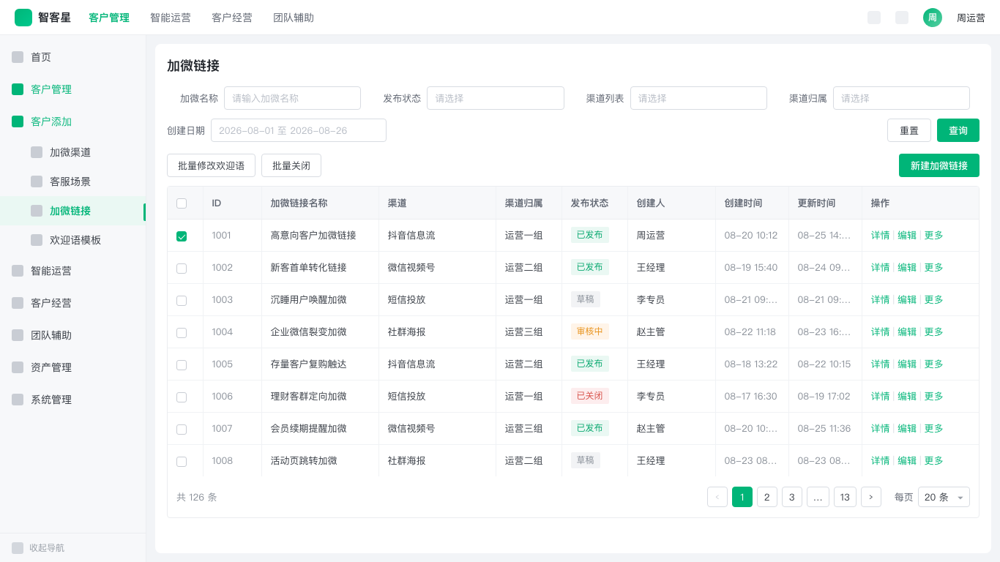

# qifu-list-page

> 在 Figma 中按命名组合,使用「奇富科技中后台组件库 新」的真实组件实例生成奇富后台列表页。**统一入口，跨平台通过 `platform` 字段切换。**

  

## 解决什么问题

把"列表 + 筛选 + 批量操作 + 分页"这类 B 端最常见页面,从一句中文描述直接生成成 Figma 真实组件实例。组件保持实例关系可编辑,不是手绘、不是截图。

## 跨平台生成

| `platform` | 平台 | `generationStrategy` | 落图方式 |
| --- | --- | --- | --- |
| `yushu` | 毓数(默认) | `assemble` | 从组件库解析组件并组装实例 |
| `generic` | 通用后台 | `assemble` | 中性占位外壳 + 组件组装 |
| `zhikexing` | 智客星 | `copyTemplate` | 复制人工基线 `4892:34812`,只改可回读属性 |

平台只决定外壳、菜单树、图标、主题与落图策略;列表页的通用结构(筛选、表格、分页、列表操作栏)跨平台复用同一套规则。

## 输入 → 输出示例

**输入**(毓数 / assemble):
```
在毓数平台的订阅管理 > 群组管理下新建群组管理列表页,
筛选用名称(Input)、状态(Select)、创建时间(DateRange),
行操作:查看 / 编辑 / 停用。
```

**输入**(智客星 / copyTemplate):
```
使用 qifu-list-page,在智客星的客户添加 > 加微链接下创建加微链接列表页,
筛选为加微名称、发布状态、渠道列表、渠道归属、创建日期,
左侧操作为批量修改欢迎语和批量关闭,右侧主操作为新建加微链接,
表格可多选,行操作:详情、编辑、更多。
```

**输出**:Figma 中保持真实组件实例关系;毓数从组件库组装实例,智客星复制人工基线整页只改可回读属性。

## 样例截图

智客星 `copyTemplate` 生成效果(加微链接列表页,1366×768):



## 6 个注册组合(assemble 平台)

| 组合名 | 场景 | 筛选栏 | 选择列 |
|---|---|---|---|
| `Qifu List Page / Basic Table` | 无筛选普通列表 | – | – |
| `Qifu List Page / Basic Filter Table` | 1–4 筛选(默认) | 单行 | – |
| `Qifu List Page / Advanced Filter Table` | 5+ 筛选 | 两行 | – |
| `Qifu List Page / Selectable Filter Table` | 需批量操作 | 单行/两行 | ✓ |
| `Qifu List Page / Loading Table` | 加载中 | 按需 | – |
| `Qifu List Page / Empty Table` | 空/失败/无权限 | 按需 | – |

**铁律**:不得临时造名或混用。`copyTemplate`(智客星)使用固定的「4+1 筛选 + selectable 表格」组合,不套用上表;结构不符时返回 `BLOCKED_TEMPLATE`。

## 快速使用

```bash
# 已按根目录 README 装好软链后,在 Claude Code 里
$qifu-list-page 在毓数平台的权限管理 > 用户授权下新建用户授权列表页,顶部位于 QBI。
```

## 文件导航

- `SKILL.md` — 双策略工作流(assemble + copyTemplate)、输入契约、失败关闭和交付规则
- `VERSION` — 当前 Skill 版本
- `references/page-rules.md` — 组合注册表、画板骨架、筛选、操作栏、表格、分页和页面级验收
- `references/component-map.md` — 列表页运行时组件映射、节点 ID、发布 Key、属性和已知缺口
- `references/component-invocation-contract.md` — 属性 Key 解析、INSTANCE_SWAP、Slot 写入和回读验证
- `references/structural-validation.md` — 结构化验收、禁止特征和 PASS/BLOCKED/FAIL 判定
- `references/platform-yushu.md` — 毓数平台基线
- `references/platform-zhikexing.md` — 智客星平台基线(copyTemplate 权威规则)
- `scripts/validate_skill_contract.py` — 文档契约校验
- `tests/test_validate_skill_contract.py` — 契约测试
- `agents/openai.yaml` — Codex 入口

## 共享依赖

`qifu-shared` 仍是抽屉、详情页和公司级设计系统的共享依赖；列表页目录内同时保留一份运行时所需的组件映射和平台基线，保证通过 GitHub 单独安装 `qifu-list-page` 时也能完整运行。更新公共平台规则时，需要同步检查 `qifu-shared/references/` 与本目录 `references/` 是否一致。

## 不适用场景

复杂分析看板、编辑表单(走 [qifu-drawer-form](../qifu-drawer-form/))、详情页(走 [qifu-detail-page](../qifu-detail-page/))、树表、高度定制工作台。

## 关键验证规则(节选)

完整清单在 [SKILL.md](./SKILL.md) 第 9 节:

- 所有组件 INSTANCE 嵌套于 `Header / SideMenu / Content / Page Surface / List Page Shell` 内,**不允许 Page 根级孤儿**
- 表头与每行列宽数组完全一致
- 操作列右侧固定 20px
- `pagination 右边缘 == table 右边缘`
- 选择列开启时 Selection Cell 数量 = 数据行数 + 1
- 启用/禁用 Tag 严格按 `light/success/medium/square`(启)/`light/danger/medium/square`(禁)
- `generationStrategy` 与 `platform` 一致:zhikexing=copyTemplate,yushu/generic=assemble
