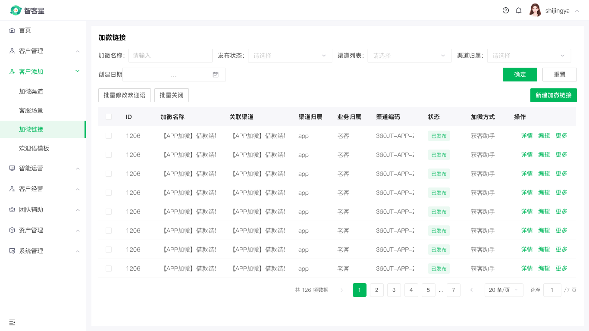

# zhikexing-list-page

> ⚠️ 本 skill 已并入 [`qifu-list-page`](../qifu-list-page/SKILL.md)。智客星列表页现在通过 `qifu-list-page` 的 `platform=zhikexing`（`copyTemplate` 策略）生成，本目录仅保留为兼容入口与 `qifu-drawer-form` 底图协议依赖源。

## 迁移后怎么用

```text
使用 qifu-list-page，在智客星的“客户添加 > 加微链接”下创建加微链接列表页；
筛选为加微名称、发布状态、渠道列表、渠道归属、创建日期，
左侧操作为批量修改欢迎语和批量关闭，右侧主操作为新建加微链接，
表格可多选，行操作为详情、编辑、更多。
```

`platform=zhikexing` 自动触发 `copyTemplate`：复制人工基线 `4892:34812`（`Template / List Page / 智客星 / 1440 / 手动调整`，实际 `1366 x 768`），只改可回读属性，不直接写 Slot。

## 基线模板（权威声明在 qifu-shared）

| 项目 | 值 |
| --- | --- |
| Figma 文件 | `gTV3VdC6a5e9vpkRHIZSXA` |
| 模板节点 | `4892:34812` |
| 模板名称 | `Template / List Page / 智客星 / 1440 / 手动调整` |
| 实际画板 | `1366 x 768` |
| 页面组合 | 4+1 筛选、按钮触发、可选择表格、批量操作、右侧主操作、表格内分页 |

## 本目录保留原因

`qifu-drawer-form` 的「智客星列表页底图协议」仍引用本目录 `references/` 验证抽屉底图。因此：

- `references/` 保留，作为 `copyTemplate` 详细契约与抽屉底图验收依据。
- 权威落图规则在 [`qifu-list-page/SKILL.md`](../qifu-list-page/SKILL.md) 4b 节与 [`qifu-shared/references/platform-zhikexing.md`](../qifu-shared/references/platform-zhikexing.md)。
- 改智客星规则时改 `qifu-shared`，本目录不再承载独立落图逻辑。

## 文件导航（兼容）

- `references/platform-zhikexing.md`：智客星外壳、菜单和变量规则（已标注权威源）。
- `references/component-invocation-contract.md`：属性写入和 Slot 边界。
- `references/structural-validation.md`：结构与截图验收。
- `references/component-map.md`、`references/page-rules.md`：模板内组件映射与几何（历史保留）。

## 验证截图


